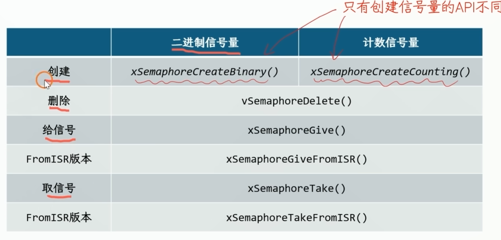
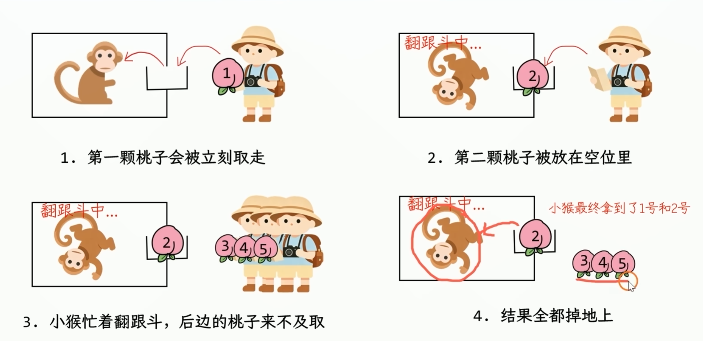
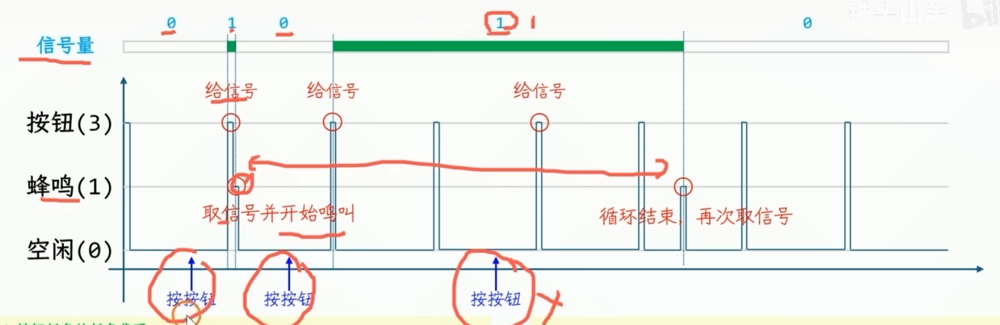
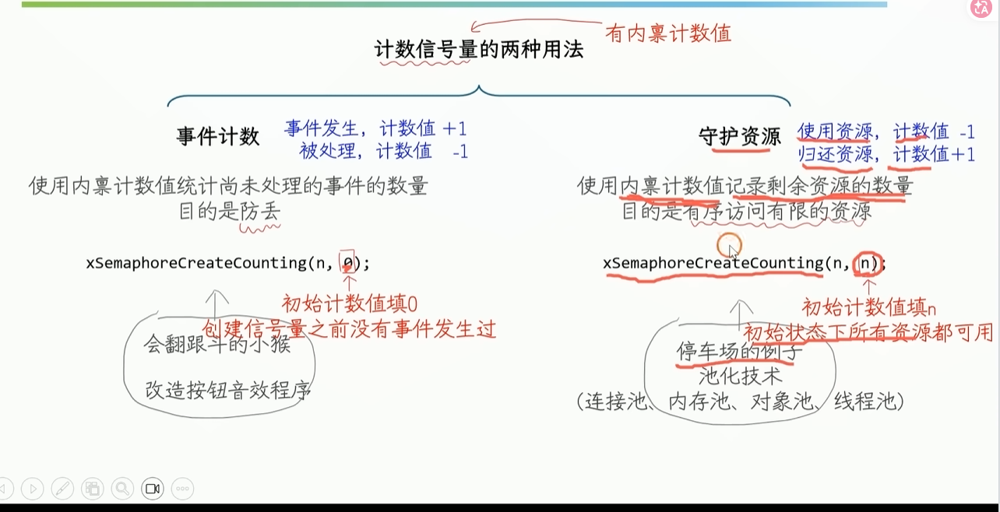

这两者的不同如下

| 二进制信号量 | 只能表示两种状态: 有信号1和无信号0                                     |
| ------ | ------------------------------------------------------- |
| 计数信号量  | 不仅能够表示信号的有无，还能记录信号的数量(内禀计数值给信号+1 取信号-1)这个内禀计数值能够防止信号的丢失 |
根据这个性质 我们可以改进(p2.1按键分蜂鸣器鸣叫)的代码(p5.2) 因为如果按的过快的话或者蜂鸣器工作时间过长的话 信号会丢失


第二个参数也是一开始给多少个信号的意思
```
void Buzzer_Init(void)
{
xBuzzerSemphr = xSemaphoreCreateCounting(10, 0);
}
```

## 二.计数信号量的两种典型用法
 
以停车场的例子为例，剩余资源就是剩余空车位的数量 入场取信号 资源-1 出场给信号 资源+1

下面我们为这个停车场的例子编写代码
1.用开发板上的KEY1-4 代表四辆车 代表四个车位资源 按下表示入场 再次按下表示出场
我们先为按键编写驱动代码
```
static void WaitForKeyClick(GPIO_TypeDef* GPIO_Port, uint16_t GPIO_Pin);
/* USER CODE BEGIN PFP */
static void WaitForKeyClick(GPIO_TypeDef* GPIO_Port, uint16_t GPIO_Pin)
{
GPIO_PinState previous = GPIO_PIN_SET;
GPIO_PinState current = GPIO_PIN_SET;
for(;;)
{
current = HAL_GPIO_ReadPin(GPIO_Port, GPIO_Pin);
if (previous != current && current == GPIO_PIN_SET)
{
return;
}
previous = current;
vTaskDelay(pdMS_TO_TICKS(10));
}
}
/* USER CODE END PFP */
```
2.使用任务参数的方法 为每个车辆编写代码 因为如果单纯编写任务代码的话 代码量会很大
所以我们用结构体的方式
```
// 先在Private typedef中定义车辆结构体
typedef struct{
	GPIO_TypeDef* GPIO_Port; //点开GPIO的定义可以看到GPIO的引脚是用宏定义指针指向基地址的所以我们这里要定义指针类型
	uint16_t GPIO_Pin;
	const char* name;
}Car_TypeDef;
// 然后我们创建四辆车结构体变量
const Car_TypeDef car1 = {.GPIO_Port = KEY1_GPIO_Port, .GPIO_Pin = KEY1_Pin, .name = "汽车1"};
const Car_TypeDef car1 = {.GPIO_Port = KEY2_GPIO_Port, .GPIO_Pin = KEY2_Pin, .name = "汽车2"};
const Car_TypeDef car1 = {.GPIO_Port = KEY3_GPIO_Port, .GPIO_Pin = KEY3_Pin, .name = "汽车3"};
const Car_TypeDef car1 = {.GPIO_Port = KEY4_GPIO_Port, .GPIO_Pin = KEY4_Pin, .name = "汽车4"};
//创建完成后我们要创建汽车任务的相关代码在此之前我们要先定义计数信号量以及串口发送数据的函数 四个结构体共用一个代码是我们的初衷
在Private variables中定义
SemaphoreHandle_t xSemaphore1; 然后再main中任务调度开启之前定义xSemaphore1 = xSemaphoreCreateCounting(3,3);
//然后定义串口发送数据的函数
static void PrintString2(const char* str1, const char* str2)
{
vTaskSuspendAll(); //因为uart传输 具有不可重入的特点 所以要在发送之前暂停任务调度
HAL_UART_Transmit(&huart1, (const uint8_t*)str1, strlen(str1), HAL_MAX_DELAY);
HAL_UART_Transmit(&huart1, (const uint8_t*)str2, strlen(str2), HAL_MAX_DELAY);
xTaskResumeAll();
}
static void vCarTask(void* pvParameters)
{
	Car_TypeDef* car = (Car_TypeDef*) pvParameters; //将传进来的car的结构体变量强制转成结构体指针类型存到car中去
	
	for(;;) //for循环不断刷新状态
	{
		WaitForKeyClick(car->GPIO_Port, car->GPIO_Pin); //等待第一次按键按下 表示取信号量车辆入场
		if(xSemaphoreTake(xSemaphore1, pdMS_TO_TICKS(10000)) == pdPASS)
		{
			PrintString2(car->name, "入场。\n");
		}else
		{
			PrintString2(car->name, "入场失败。\n");
			continue; 跳出判断重新进入for循环以防执行下边的出场代码
		}
		
	}
	WaitForKeyClick(car->GPIO_Port, car->GPIO_Pin); //等待第二次按钮按下表示给信号 车辆出厂
	xSemaphoreGive(xSemaphore1); //给信号到计数信号量
	PrintString2(car->name, "出场。\n");
最后main函数
xTaskCreate(vCarTask, "A", 64, (void*)&car1, 1, NULL);
xTaskCreate(vCarTask, "B", 64, (void*)&car2, 1, NULL);
xTaskCreate(vCarTask, "C", 64, (void*)&car3, 1, NULL);
xTaskCreate(vCarTask, "D", 64, (void*)&car4, 1, NULL);
vTaskStartScheduler();
}
```


